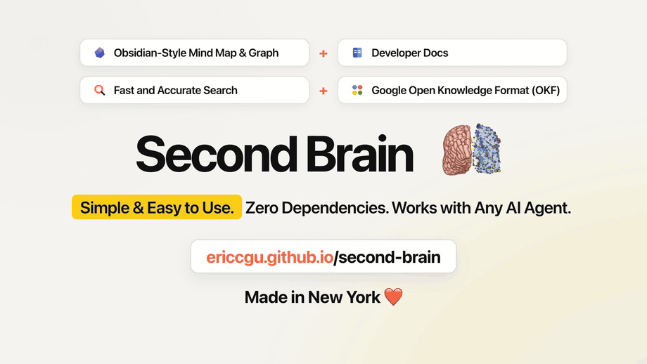

# Hey, I'm Eric Gu

New York, NY · [LinkedIn](https://www.linkedin.com/in/ericcgu/) · [Second Brain](https://ericcgu.github.io/second-brain/)

I have a strong background in data engineering, pipelines, and networking, and my work focuses on AI defense, vulnerability detection engineering, and red teaming. I also focus on UX/UI, specifically Generative UI, Agentic UI, and scalable, real-time, data-driven interfaces, and I enjoy making video content using motion graphics and kinetic typography. Right now I'm building an **Agentic Red Team Pen Testing Platform**.

### What I'm building

**Agentic Red Team Pen Testing Platform**  
Multi-agent workflows for offensive security, vulnerability detection, and automated remediation. Currently in development.

**[Second Brain](https://github.com/ericcgu/second-brain)** · [Live Site](https://ericcgu.github.io/second-brain/) · [Watch Launch Video (MP4)](https://github.com/ericcgu/second-brain/blob/main/videos/second-brain-launch.mp4) · [Mind Map](https://ericcgu.github.io/second-brain/mindmap/) · [Knowledge Graph](https://ericcgu.github.io/second-brain/graph/)  
A plain-Markdown knowledge workspace with an interactive mind map, knowledge graph, developer docs, and fast client-side search. Built on Google's Open Knowledge Format to work with any AI agent, with zero dependencies.

**[Juniper Mist Automation Lab](https://github.com/ericcgu/eg-juniper-mist-automation-lab)**  
A hands-on lab for learning the Mist Cloud APIs through Python files with runnable notebook-style cells in VS Code.

### What I'm exploring

- **Agentic AI & AI defense:** Multi-agent systems that plan, verify, and fix security issues across code and infrastructure.
- **Vulnerability detection & data pipelines:** Pairing deterministic analysis with AI models over structured security data pipelines and network configs.
- **Generative UI & Agentic UI:** Designing scalable, real-time, data-driven interfaces where AI agents stream, adapt, and render interactive views on the fly.
- **Launch, marketing, & explainer videos:** Producing product launch videos, marketing videos, and explainers with motion graphics and kinetic typography.
